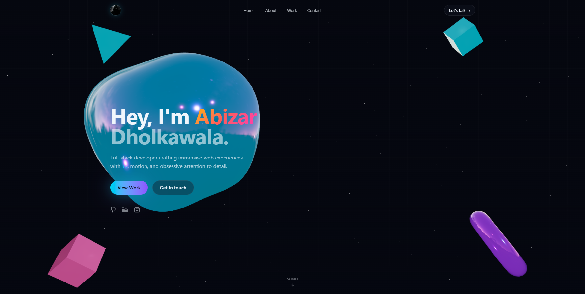

# Abizar's Portfolio

A modern, visually stunning personal portfolio website designed to showcase my skills, projects, and professional journey. Built with a focus on interactive 3D elements, smooth animations, and a premium user experience.



## ✨ Features

- **Interactive 3D Backgrounds**: Powered by React Three Fiber for a dynamic, engaging visual experience.
- **Smooth Animations**: Seamless page transitions and micro-interactions built with Framer Motion.
- **Responsive Design**: Flawless experience across desktop, tablet, and mobile devices using Tailwind CSS.
- **Secure Contact Form**: Integrated with EmailJS for direct messaging and protected by Cloudflare Turnstile CAPTCHA.
- **Project Showcase**: A dedicated section to display professional work with filtering and details.
- **Modern Tech Stack**: Leveraging the latest features of React 19 and Vite for optimal performance.

## 🛠️ Technology Stack

- **Framework**: [React 19](https://react.dev/)
- **Build Tool**: [Vite](https://vitejs.dev/)
- **Styling**: [Tailwind CSS 4](https://tailwindcss.com/)
- **Animations**: [Framer Motion](https://www.framer.com/motion/)
- **3D Graphics**: [Three.js](https://threejs.org/) & [@react-three/fiber](https://docs.pmnd.rs/react-three-fiber)
- **UI Components**: [Radix UI](https://www.radix-ui.com/)
- **Form Handling**: [React Hook Form](https://react-hook-form.com/) & [Zod](https://zod.dev/)

## 🚀 Getting Started

To get a local copy up and running, follow these simple steps.

### Prerequisites

Make sure you have Node.js installed on your machine.
- Node.js (v18 or higher recommended)
- npm, yarn, or bun

### Installation

1. Clone the repository:
   ```bash
   git clone https://github.com/abizardholkawala/abizars-portfolio.git
   ```
2. Navigate to the project directory:
   ```bash
   cd abizars-portfolio
   ```
3. Install dependencies:
   ```bash
   npm install
   ```
   *(or use `bun install` / `yarn install`)*

4. Create a `.env` file in the root directory and add your necessary environment variables (e.g., EmailJS keys, Turnstile site key).

5. Start the development server:
   ```bash
   npm run dev
   ```

## 📜 License

Distributed under the MIT License. See `LICENSE` for more information.

## 📫 Contact

Abizar Dholkawala - Contactsabizar@gmail.com

Project Link: [https://github.com/abizardholkawala/abizars-portfolio](https://github.com/abizardholkawala/abizars-portfolio)
